# Application ecommerce 
L'objectif est de créer une application basée sur une architecture micro-service qui permet de gérer les factures contenant des produits et appartenant à un client.

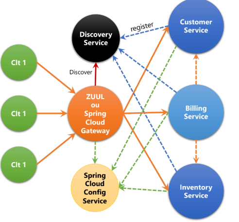
## Service Customer 
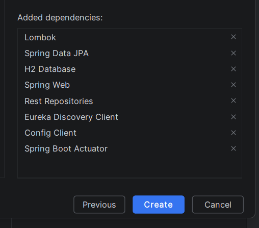

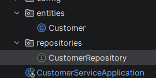

## Service inventory 

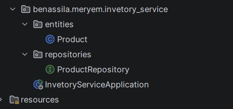
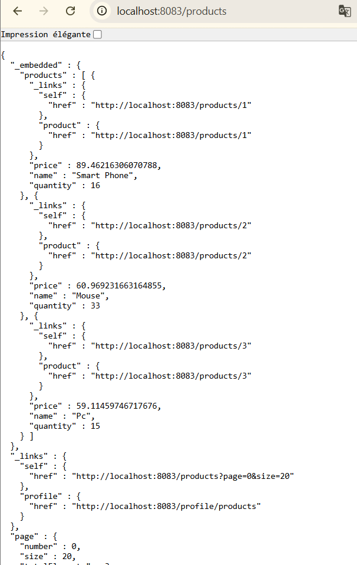

## Service Gateway 
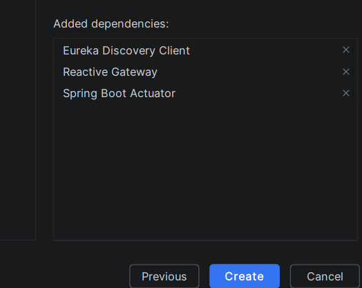
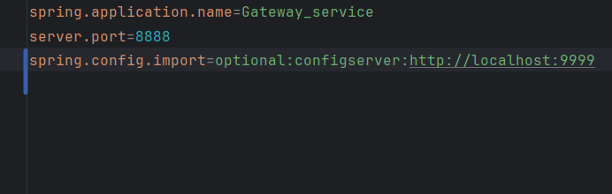
- configuration de gateway de manière statique :

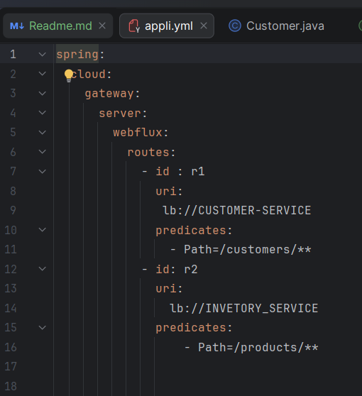

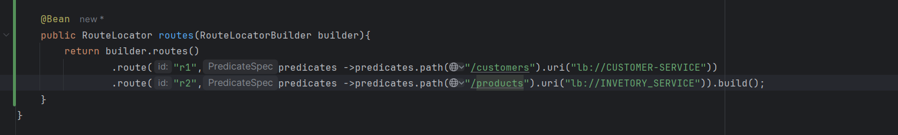

## Service de discovery 
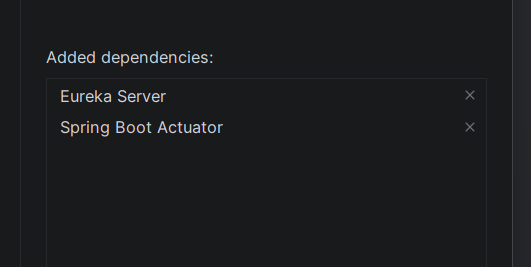
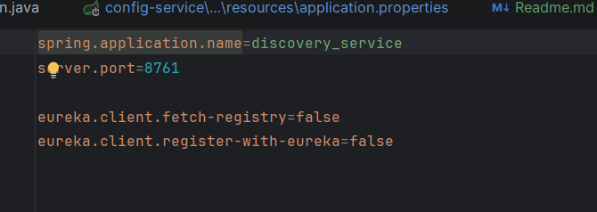
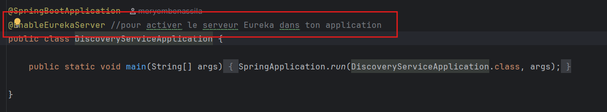
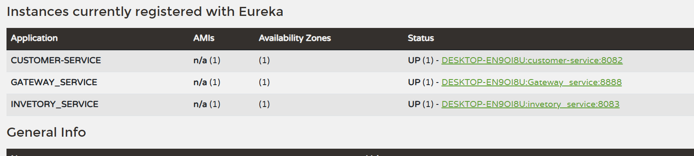

- configuration de gateway de manière dynamique  :

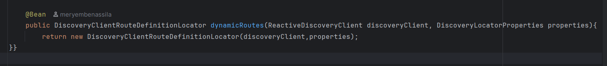

## Service Builing 
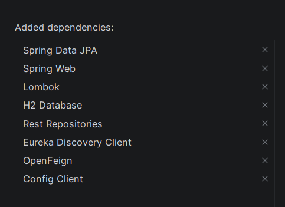
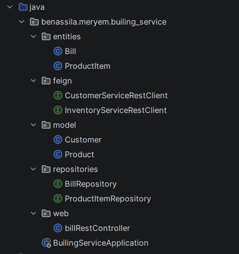
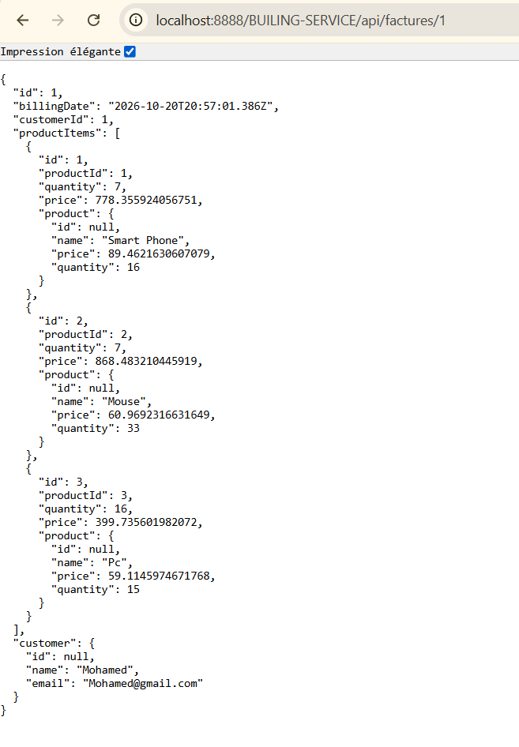
### Gestion de tolerance au panne 
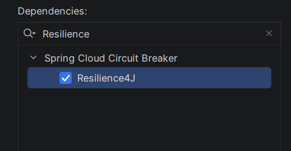
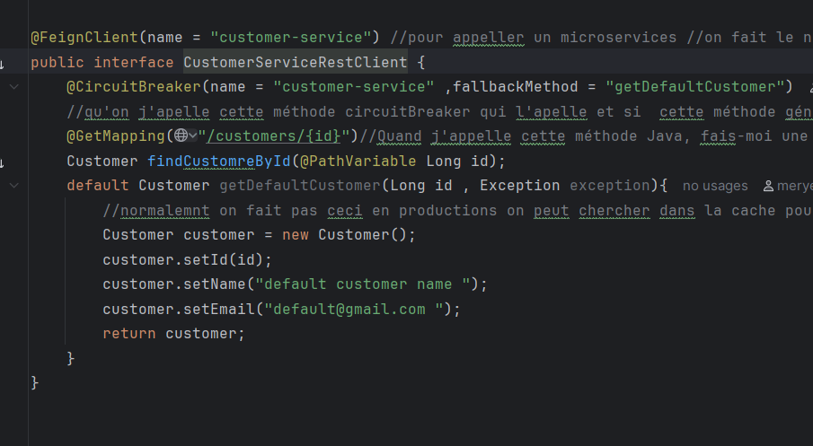

## Service de configuration 
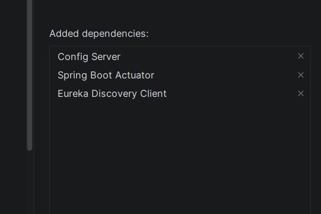
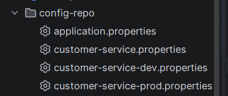
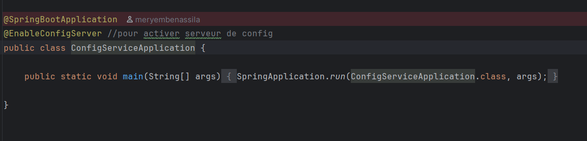

- Utilser la configuartion dans le microservice customer
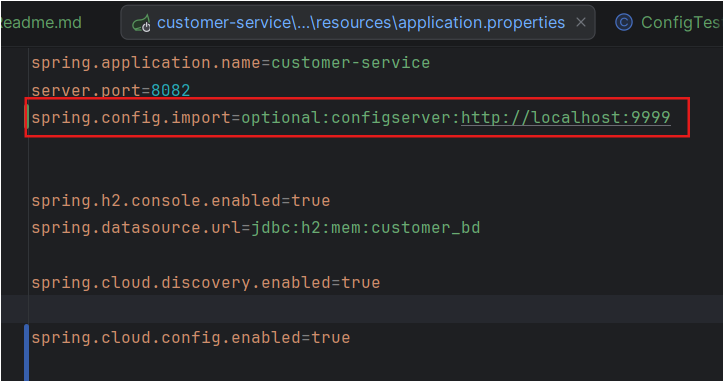

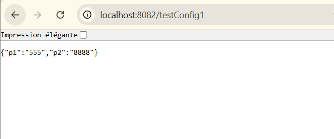

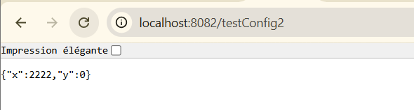

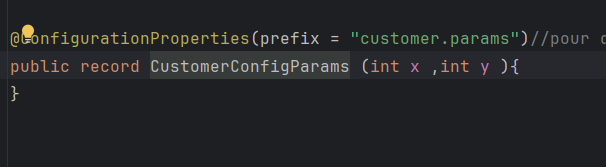

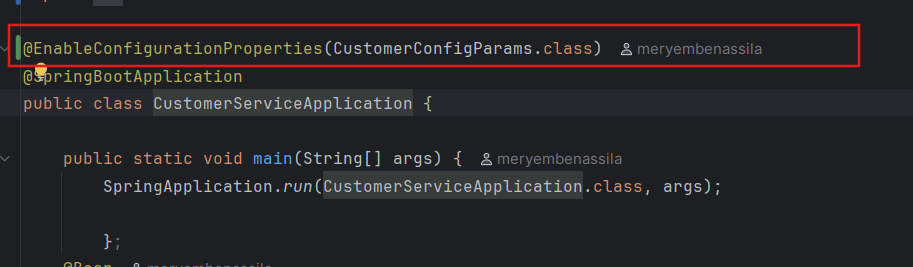
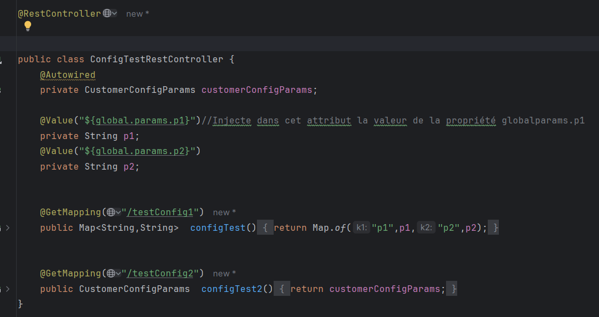

- Modification de configuration centralisé

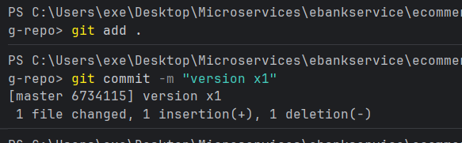
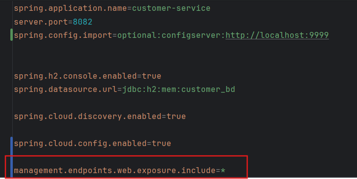
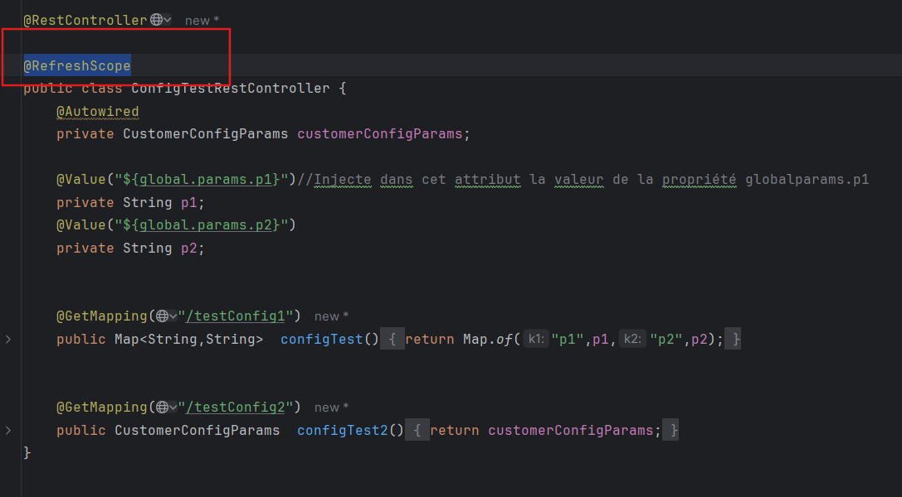
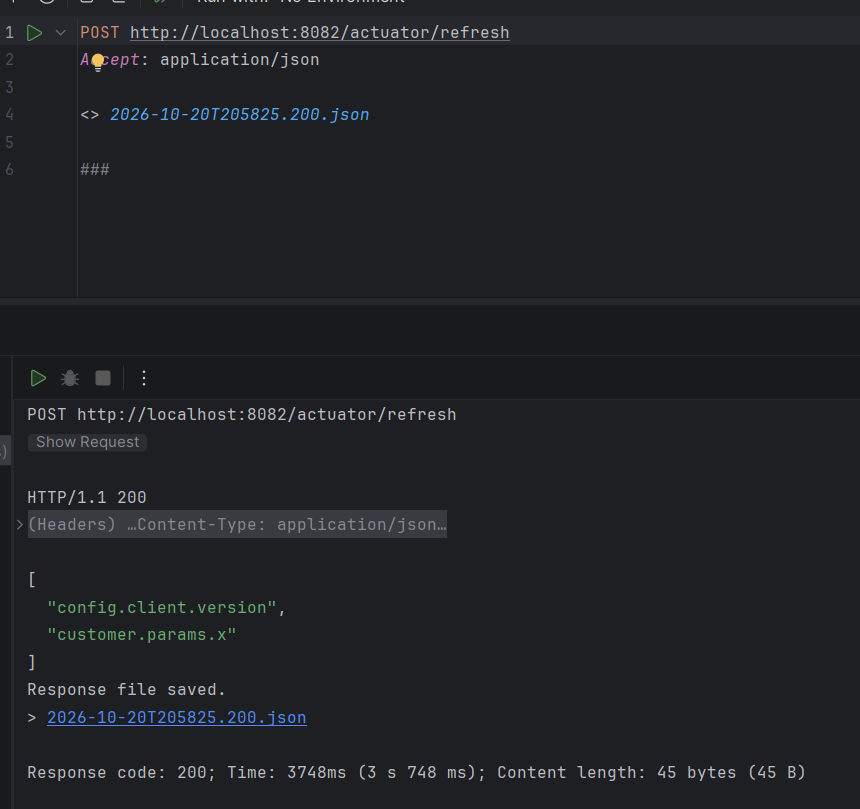

- Utilser la configuration pour tous les microservices 
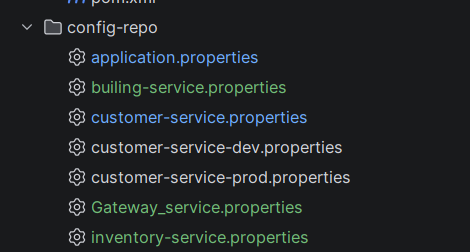
- utilser un repo distant pour la configuration 
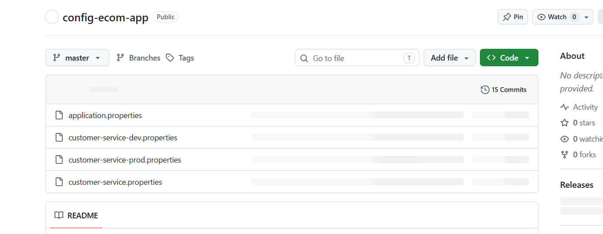